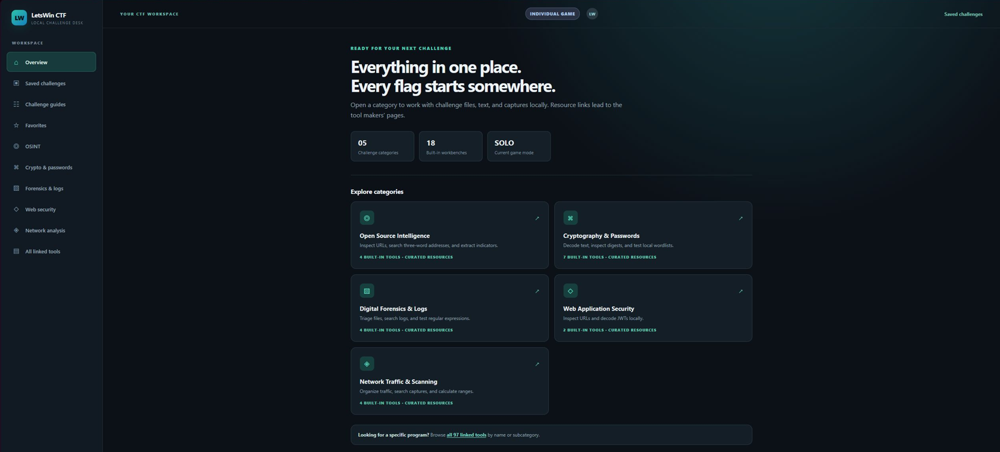

# LetsWin CTF — User guide

LetsWin CTF is a local CTF investigation desk with **19 workbenches, five categories, and 94 linked resources**. It processes material you provide. It does not connect to a competition platform or submit answers.



*Actual app screenshot captured on October 26, 2026. Captured before the catalog cleanup; the current app has 19 workbenches and 94 linked resources. Browser chrome was cropped out; the interface was not reconstructed.*

## Start and choose a mode

Open `LetsWin CTF.html`, or use the Windows `.cmd` launcher. On macOS, open the HTML directly; the optional `.command` launcher requires executable permission. No server, installation, API key, or account is needed for the local workbenches. External links require internet access.

Choose a mode before accessing tools:

| Mode | Behavior |
| --- | --- |
| Individual | Local, deterministic tools and static guides. No AI link or team notes. |
| Team | The same tools, temporary team notes, and a manually opened ChatGPT link. Follow your event's AI limits. |

The supplied team rules describe consumer-available models, a $50/month limit, and a 32 GB VRAM limit for local models. The app does not enforce external subscriptions or inspect external AI use. No AI service receives data automatically.

Switching modes clears temporary results, loaded files, selections, and team notes. Each mode has its own saved challenges, recipes, and favorites. Mode separation is a workflow feature, not authentication or encryption.

## Save a challenge and resume later

1. Open **Saved challenges → New challenge**.
2. Enter a title, category, status, description, investigation notes, and candidate flag. Edits autosave to this browser when storage is available.
3. Use **Record file metadata** to remember filenames, byte sizes, and MIME types. File contents are not saved; reopen the originals when resuming.
4. Run a workbench and choose **Save result to challenge**. The active challenge is shown in the top bar.
5. Use **Export workspace JSON** regularly. It includes this mode's challenges, results, favorites, and recipes in plain text.

To restore, choose the same game mode, import the JSON, review the challenge count, and choose **Replace workspace with this backup**. Import replaces that mode's current workspace. Export first if you want to preserve both. A backup for the other mode is rejected.

Storage depends on the browser and file location. Private browsing, clearing browser data, moving the HTML, or changing browsers may affect persistence. If storage is blocked or full, the app keeps work in the current tab and displays an export warning. There is no cloud sync.

Limits: 100 challenges per mode; 50 results and 100 file records per challenge; 100,000 characters per description, notes field, or saved result; 2,000 characters per candidate flag; 50 recipes and 200 favorite links. Import accepts up to 6 MB and normalizes fields to those limits.

## Follow a guide

**Challenge guides** contains static checklists for OSINT, cryptography, forensics, web security, and network analysis. Each includes a worked example and buttons for relevant local tools. These guides do not call AI and are available in Individual mode.

## Move data between tools

Every workbench includes **Send result to**. Choose Encoding, Hashing, RegEx, Indicators, Logs, Ciphers, or Recipe, then choose **Send result**. This fills the destination input without running it automatically.

To transfer a smaller part, highlight text in the content area and use **Send selected text**. Results that contain structured objects transfer as their displayed JSON text.

## Identify source code

Open **Forensics & logs → Code Identifier** (also available under **Web security**), paste a snippet, and choose **Identify pasted code**. An optional filename supplies an additional hint. **Open source file** loads and analyzes a UTF-8 file, or UTF-16 with a byte-order mark. Files are limited to 1 MB and decoded text to 200,000 characters.

The result shows the likely language or format, usual runtime/toolchain, alternative candidates, and the syntax clues with line numbers. Confidence labels are heuristic, not probabilities. Filename and Markdown fence labels alone produce low confidence. The tool recognizes 25 languages and formats, including Python, JavaScript, TypeScript, PHP, C/C++, C#, Java, Go, Rust, Ruby, Perl, Lua, PowerShell, shell, batch, SQL, HTML, CSS, JSON, XML, YAML, Assembly, Swift, and Kotlin.

Use **Send result to → Code Identifier** to inspect output from other workbenches. Results can be copied or saved to a challenge. Both game modes use the same deterministic local rules; there is no AI request, execution, compilation, or upload. Binary files belong in File Triage. Short, mixed, incomplete, or obfuscated code can remain ambiguous. Detection cannot establish the exact program that created a snippet, explain arbitrary behavior, or certify safety.

## Crypto and conversion recipes

| Workbench | Use |
| --- | --- |
| Encoding | Base64, UTF-8 hex, URL encoding, ROT13 |
| SHA-256 Hasher | Hash text or a local file |
| Multi-hash | MD5, SHA-1, SHA-256, and NTLM text hashes; salted-format hints |
| Hash Type Hints | Digest shape and length candidates |
| Local SHA-256 Wordlist | Compare supplied candidates against one digest |
| Classical Ciphers | Caesar, Vigenère, XOR, Morse, and binary |
| Conversion Recipes | Run and save up to 12 encoding operations in order |

Multi-hash's NTLM operation is MD4 over UTF-16LE text. Other text hashes use UTF-8. Newlines and spaces count. Salted hints recognize bcrypt, Argon2, scrypt, MD5-crypt, SHA-crypt, PBKDF2, and digest:salt shapes; recognition is not cracking or verification.

For Caesar, enter an integer shift. For Vigenère, use an A–Z key. XOR takes a UTF-8 key and returns hex ciphertext when encoding; decoding expects hex and returns UTF-8 text. Arbitrary binary plaintext that is not UTF-8 is rejected. Morse uses spaces between letters and `/` between words. Binary uses 8-bit UTF-8 bytes.

Recipe example: input `ZmxhZ3tkZW1vfQ==`, add **base64 → decode**, then **Run recipe**. Output is `flag{demo}`. Give it a name and save it. Saving the same name updates that recipe. Keys and recipe input are not saved with recipes.

## Search and organize logs

**Traffic & Log Viewer** accepts pasted text and files: plain logs, CSV, TSV, JSON, JSONL, PCAP, and PCAPNG. Unknown binary files receive a hex/text preview.

- Search text or use JavaScript RegEx, with `i`, `m`, `s`, and `u` flags. Patterns run in a worker with a one-second timeout.
- Sort columns, page through results, and export the filtered rows as CSV. CSV output protects spreadsheet formula-like fields by prefixing an apostrophe.
- Expand **Time filters, groups & duplicates**, select the timestamp/group columns, and set a UTC range.
- Enter a display timezone such as `UTC` or `America/New_York`. This changes table display, not the original values or CSV timestamps.
- Inspect top group counts and a timeline by UTC minute. The timeline shows the first 30 occupied minutes and the total number of occupied minutes.
- **Show duplicate rows only** compares every field except row/line numbers. Different timestamps are different rows. Grouping can help investigate repeated messages across different times.

ISO timestamps without an offset are treated as UTC. Unix seconds/milliseconds are recognized. Syslog timestamps without a year are left unknown; the app does not invent the year. Unknown timestamps are excluded only when a time range is active. Text/RegEx search and analytics filters combine.

## Inspect traffic and export bodies

Open **Network analysis → Stream & Protocol Analysis** and select a PCAP or PCAPNG.

1. Choose a TCP endpoint pair and direction.
2. Check gap, retransmission/overlap, and conflicting-byte counts.
3. Expand contiguous runs to preview text or export their exact bytes.
4. Expand supported HTTP/1 messages to inspect headers. Complete Content-Length and chunked bodies can be exported. Content encoding, such as gzip, remains unchanged.
5. Inspect DNS questions and answers for A, AAAA, CNAME, NS, PTR, MX, and TXT, including DNS over TCP when framed data is present.

Try [practice-traffic.pcap](examples/practice-traffic.pcap). It includes an out-of-order HTTP response, a retransmission, and a DNS response. The complete HTTP body exports as `flag{stream_demo}`.

Limits matter when interpreting results:

- TCP is grouped by endpoint pair, not connection epoch. Reused connections may overlap.
- Sequence spans over 2 GiB, IP fragmentation reassembly, TLS decryption, HTTP/2, and HTTP/3 are unsupported.
- Missing TCP bytes create separate runs; gaps are never filled with invented data.
- Conflicting overlaps keep the segment with the earlier sequence start (capture order for equal starts). HTTP body export is disabled for that direction when conflicts exist.
- Bodies that depend on connection closure have unknown completeness and are not offered as complete exports. HEAD request/response pairing is not inferred.
- HTTP parsing begins at a contiguous run's start. A run beginning mid-message may not produce HTTP results. Use the raw run or Wireshark for deeper investigation.

## Image Lab

Open a PNG or JPEG in **Image Lab** to inspect selected metadata, EXIF orientation, capture time, GPS, dimensions, and bytes after JPEG EOI or PNG IEND.

- Choose original, red, green, blue, or alpha pixels.
- Choose all bits or a bit plane from 0 (least significant) to 7.
- Apply the view, then decode a QR code from those displayed pixels.
- Export the displayed PNG or the exact appended bytes.

QR decoding uses bundled jsQR locally. Detected text is displayed without opening it. GPS coordinates are displayed without visiting a map automatically. Browser image decoding can apply orientation/color conversions, so pixel views are an inspection aid rather than a raw file-byte representation. PNG compressed text fields and complete EXIF coverage are not implemented. A missing metadata field does not prove that no metadata exists.

Try [practice-qr.png](examples/practice-qr.png): QR output is `flag{local_qr_works}`. Try [practice-appended.png](examples/practice-appended.png) for appended-byte export. These are generated practice fixtures, not screenshots.

## Linked tools, favorites, and what3words

The directory includes the requested md5decrypt top choice, hash lookup tools, Cryptii, QR decoder, text-to-PCAP, what3words, and the 62 retained entries imported from [gregalletti/CTF_tools](https://github.com/gregalletti/CTF_tools). Existing equivalent links are merged.

Expand **Usage & example** for purpose, starter guidance, platform information, and cost caveats. Where provider details have not been verified, the card explicitly says to check the provider. **☆ Favorite** saves a resource for the selected game mode.

For what3words, enter `///clip.apples.leap` in **what3words Map Search**. The app constructs an official map link; you choose whether to open it. The map provider resolves the location. The app does not geocode offline or supply a what3words API key.

External links open separately and can have accounts, charges, outages, or changing capabilities. The requested text-to-PCAP URL previously returned HTTP 502 and is retained with a note. The local app cannot guarantee external services or control their uploads and AI features.

## Practical limits and troubleshooting

| Area | Limit / behavior |
| --- | --- |
| Log/capture files | 20 MB; 10,000 displayed rows/packets; up to 30 structured columns |
| Text organization | First 2 million characters |
| Packet preview | First 2,048 packet bytes as text; 512 as hex |
| Unknown binary preview | First 64 KB |
| File triage | First 1 MB |
| SHA-256 files | 100 MB with Web Crypto; 20 MB fallback when unavailable |
| Text hashes/ciphers/recipes | 2 million characters; recipe intermediate/output also capped |
| Wordlist | 10,000 candidates; SHA-256 only |
| RegEx | 200-character pattern; one second; first 100 matches |
| Images | PNG/JPEG, 20 MB and 16 megapixels; large QR decoding can take time |
| TCP run preview | 100 KB text; binary export includes the full run |

If changes do not appear, reload the HTML after rebuilding. Save/export work before reloading. If copying fails due to browser permissions, select the result and copy it manually. If an unfamiliar format cannot be decoded, preserve the original and use the linked specialist tool.

## Verification and development

Read the [test report](TEST_REPORT.md) for exactly what was checked and what remains unverified. Passing automated tests does not establish a 100% guarantee across arbitrary input files, browsers, operating systems, and third-party websites.

From the project folder, with Node.js 22 or newer and pnpm installed:

```text
pnpm install --frozen-lockfile --ignore-scripts
node build.cjs
node tests/run.cjs
```

Runtime libraries are vendored; opening the app does not download them. See [third-party notices](THIRD_PARTY.md).
